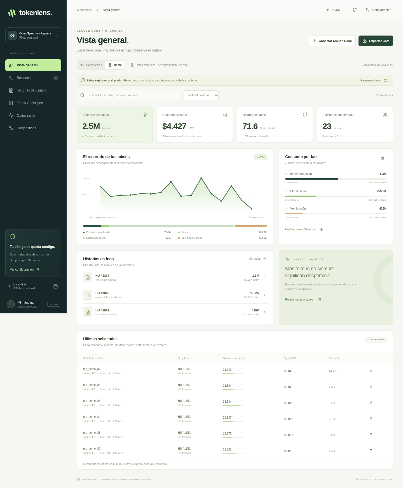

# TokenLens · piloto local

Observabilidad de consumo de **Claude Code en VS Code + OpenSpec**, para una persona y una máquina. Backend Python / FastAPI / Uvicorn, frontend React y SQLite. No necesitas desplegar un servidor externo, contratar una API de Claude ni instalar Node para usar el paquete compilado.

> **Estado:** piloto funcional, no producto corporativo ni medidor de facturación. Probado con contratos OTLP sintéticos y navegador real en Linux. **La exportación de TU versión de la extensión todavía debe validarse en TU equipo.** Los datos demo están separados de los reales. No se ha capturado tu actividad ni se han modificado tus settings desde Arena.



## 1. Inicio rápido

Requisitos: Python **3.11–3.13**, navegador moderno y permiso para instalar paquetes Python. La instalación inicial necesita acceso a PyPI; después, TokenLens no realiza llamadas externas. Claude Code conserva su conexión normal a Anthropic; TokenLens no la reemplaza.

Descomprime el ZIP y entra en la carpeta `tokenlens`:

```bash
python pilot.py setup
python pilot.py run
```

Abre **http://127.0.0.1:4318**. `run` también instala dependencias si aún no existe el entorno local `.venv`. El frontend React **ya viene compilado** y Uvicorn lo sirve junto con la API. Un solo proceso; sin Vite, Docker, Redis o PostgreSQL en ejecución.

- Windows: puedes usar `py -3.13 pilot.py setup` y `py -3.13 pilot.py run` si `python` no existe.
- macOS / Linux: usa `python3` si corresponde.
- `Ctrl+C` detiene el servidor.
- Cambia el puerto con `python pilot.py run --port 4320` si 4318 está ocupado. Debes usar el mismo puerto al configurar Claude.
- Instala TokenLens en una carpeta privada, **fuera del repositorio de código que Claude modificará**.

### Explorar sin Claude

Pulsa **Demo**. Se generan datos sintéticos aislados con tres sesiones y 87 solicitudes. No llama a un LLM ni consume tokens. **Datos reales** permanecerá vacío hasta recibir telemetría. Regenerar la demo borra solo la fuente demo, incluyendo sus anotaciones.

## 2. Conectar Claude Code

Con el servidor levantado, abre otra terminal en la carpeta de TokenLens:

```bash
python pilot.py init --project "/ruta/absoluta/a/tu/repositorio"
```

Ejemplo Windows:

```powershell
py -3.13 pilot.py init --project "C:\repos\mi-proyecto"
```

El instalador:

1. Valida que los settings sean JSON antes de editarlos.
2. Respalda los archivos originales, incluidos sus bytes exactos.
3. Configura OTLP HTTP/protobuf en `~/.claude/settings.json`.
4. Añade hooks de comandos en `<repo>/.claude/settings.local.json`, conservando otros hooks.
5. Limita esos hooks al repositorio indicado y sus subcarpetas.
6. Desactiva explícitamente exportación de prompts, respuestas, cuerpos de API y contenido de herramientas.
7. Genera una credencial **local de ingesta**, no una API key de Claude.

**Reinicia completamente VS Code**, no solo una pestaña de chat. Envía un prompt corto desde la extensión. Abre **Sesiones** y **Diagnósticos** en TokenLens.

> La configuración de telemetría es de usuario: **otras sesiones de Claude Code de ese usuario también pueden exportar mientras el piloto esté activo**. Sus consumos se conservarán sin HU si no tienen hooks del proyecto. El filtro de proyecto limita hooks, NO constituye un filtro de transporte OTel. Cierra sesiones ajenas al piloto y restaura la configuración al terminar. No se exporta contenido de esas conversaciones.

Si ya hay configuración de observabilidad, el instalador se detiene sin reemplazarla. Después de revisar los conflictos, puedes autorizar el reemplazo con:

```bash
python pilot.py init --project "/ruta/al/repo" --replace-telemetry
```

No utiliza ni modifica settings administrados. **Políticas corporativas, variables heredadas de la shell o hooks deshabilitados pueden prevalecer** y deben verificarse. Consulta con tu responsable antes de sustituir telemetría corporativa. No uses `--replace-telemetry` sin revisar.

### WSL, Remote SSH y dev containers

La extensión, hooks y receptor deben poder comunicarse en el **mismo entorno de ejecución**. `127.0.0.1` dentro de un contenedor o host SSH no es tu máquina Windows. Para este primer piloto usa VS Code local, o instala todo dentro de la misma distribución WSL y verifica la conexión local. No abras el receptor en la red como solución rápida. Los escenarios remotos no fueron validados aquí.

## 3. Medir una HU completa

1. Inicia una sesión y envía un prompt de comprobación.
2. En **Sesiones → Asignar HU / fase**, introduce:
   - HU Azure, por ejemplo `1842`.
   - Cambio OpenSpec, por ejemplo `mejorar-timeouts`.
   - Fase: discovery, enrichment, planning, proposal, specs, design, tasks, apply, verify o close.
3. Elige **Solo próximas peticiones**. Esto no modifica el pasado ni una petición ya iniciada.
4. Antes de cada nueva etapa del flujo, cambia la fase en TokenLens.
5. Si abres otro chat para la misma HU, asígnale la misma HU y cambio. La vista por HU agregará ambas sesiones.
6. Revisa **Optimización** y **Detalle de solicitud/petición**.
7. Concílialo con el resumen de la misma sesión y exporta CSV.

La primera petición de comprobación puede corregirse explícitamente con **Toda esta sesión** o desde el detalle con **Esta petición**. Los cambios históricos quedan auditados; esas opciones también actualizan el contexto para próximas peticiones.

La identidad es un **alias local editable**, no una identidad corporativa autenticada. No existe SSO ni control multiusuario en esta versión.

### Fases inferidas

El hook inspecciona únicamente un prefijo slash reconocido y desecha el texto del prompt. Por ejemplo:

| Comando reconocido | Fase inferida si no hay fase explícita |
|---|---|
| `/opsx:propose`, `/openspec:proposal`, `/opsx:ff`, `/opsx:continue` | planning |
| `/opsx:apply`, `/openspec:apply` | apply |
| `/opsx:explore` | discovery |
| `/opsx:archive`, `/openspec:archive` | close |

La configuración explícita de fase prevalece. Skills invocadas por el modelo, comandos personalizados o formatos no reconocidos **no se infieren automáticamente**. Usa asignación explícita. Los comandos admitidos por TU instalación de OpenSpec pueden variar.

`/opsx:propose` puede producir varios artefactos en una ejecución. No dividimos arbitrariamente sus tokens entre proposal/design/tasks: se registra como **planning compartido**. Para separar esas etapas, deben ejecutarse y marcarse por separado. Si una solicitud cubre varios artefactos, consérvala como planning.

La revisión humana sin llamadas al modelo no genera tokens Claude y no se contabiliza como tal.

## 4. Qué ofrece el piloto

- Vista general en vivo con SSE y polling de respaldo.
- Consumo por sesión, HU, fase, modelo (en detalle y CSV) y petición.
- Desglose de entrada no cacheada, salida, lectura y escritura de caché.
- Solicitudes únicas con ID del servidor; fallback explícitamente marcado si falta.
- Mayor consumo por petición, ordenable por tokens o costo equivalente.
- Asociación explícita y auditoría de correcciones.
- Herramientas por petición: nombre, duración, tamaño reportado y estado; sin argumentos ni contenido.
- Recepción de OTLP HTTP JSON y protobuf, también gzip.
- Snapshots de métricas separados del ledger de solicitudes.
- Conciliación manual por las cuatro categorías de tokens, con diferencias persistidas.
- CSV UTF-8 con filtros de búsqueda, período, HU y sesión; protección básica de fórmulas de spreadsheet.
- Demo aislada, configuración guiada y restauración de settings.
- Cola local persistente de **hooks**, reenvío periódico y deduplicación.

**No incluye:** sincronización/ETL de chats, watcher de JSONL, API organizacional, conexión propia a Azure, cierre automático de HU, SSO, multiusuario, alertas corporativas, límites duros de gasto, conteo exacto por herramienta/archivo, estimación independiente de precios, evaluaciones automáticas de productividad o veredicto de “desperdicio”.

Las HU se identifican manualmente; no necesitas aportar PAT de Azure, tokens OAuth de Claude ni credenciales corporativas.

## 5. Interpretación correcta

```text
entrada procesada = entrada no cacheada + lectura de caché + escritura de caché
tokens procesados = entrada procesada + salida
ratio de lectura de caché = lectura de caché / entrada procesada
```

Los totales incluyen repetidas lecturas de contexto a lo largo de múltiples llamadas: **no son tokens únicos del repositorio ni tamaño de la ventana actual**.

El costo usa exclusivamente `cost_usd_micros` o `cost_usd` reportado por Claude Code. Si falta, permanece desconocido. No incorpora un tarifario inventado ni se considera factura. Si solo algunas solicitudes tienen costo, el agregado es parcial y el panel lo advierte. En la demo el costo es una fixture sintética ilustrativa, no un tarifario real validado.

La suscripción mensual no se prorratea automáticamente a cada HU. Esta herramienta no determina créditos disponibles, consumo de Claude web fuera de Code, ni gasto total de la compañía.

**Optimización muestra señales:** caché, atribución incompleta, identidades débiles y salidas de herramientas superiores a **50 KB** (umbral de diseño del piloto). Bytes no son tokens y ninguna señal demuestra que el consumo fuera innecesario. Relaciónalo con calidad, pruebas, tiempo y retrabajo.

## 6. Conciliación y prueba de aceptación en tu máquina

En **Sesiones**, el botón con check abre la conciliación de esa sesión. También existe **Diagnósticos → Nueva conciliación**.

Usa contadores completos de la misma sesión, período y modelos. No copies cifras redondeadas en k/M ni confíes en que dos herramientas incluyen exactamente los mismos subagentes o llamadas auxiliares. Guarda una nota del alcance. Una coincidencia no demuestra que no existan eventos perdidos.

Checklist mínimo antes de presentar resultados a la compañía:

- [ ] Prompt simple desde el panel de la extensión recibe eventos reales.
- [ ] Existen `session.id`, `prompt.id` y preferentemente `request_id`.
- [ ] Las cuatro categorías de tokens se reciben.
- [ ] MCP Azure, un comando OpenSpec y un subagente aparecen en el mismo alcance medido.
- [ ] Dos chats simultáneos de HUs distintas no mezclan atribuciones.
- [ ] Cambiar fase después de un prompt no altera sus solicitudes tardías.
- [ ] Eventos reenviados no duplican solicitudes con ID estable.
- [ ] Se documenta qué ocurre en cancelación, cierre abrupto y error.
- [ ] Se registra una conciliación con alcance definido y diferencias explicadas.
- [ ] Exportar CSV mantiene la fuente correcta (real/demo).
- [ ] `restore` devuelve la configuración previa.

**No validado aquí:** estos escenarios con una extensión de Claude Code auténtica y TU suscripción. Los contratos de prueba son sintéticos; la validación de proveedor es el objetivo del piloto.

## 7. Datos, seguridad y recuperación

Todos los datos se guardan por defecto en `tokenlens/data/`:

```text
config.json             credencial local de ingesta y endpoint
 tokenlens.sqlite3      ledger, metadatos, auditoría y conciliaciones
outbox/                 hooks saneados pendientes de envío
backups/                copias originales de settings
installations.json      historial de instalación/restauración
```

**No subas `data/` a Git ni compartas esa carpeta.** Los backups reproducen settings originales y pueden incluir secretos que ya existían en esos settings. Se crean permisos restrictivos en POSIX donde es posible. SQLite no cifra datos en reposo: usa cifrado de disco y controles de acceso de tu equipo. Los nombres de herramientas, repositorios, cambios y alias pueden ser sensibles aunque no sean código.

El receptor y UI se escuchan solo en **127.0.0.1** mediante `pilot.py run`. Ingesta exige una credencial local. El backend comprueba Host y Origin y rechaza orígenes externos; no habilita CORS. Esto no protege contra malware o procesos de tu mismo usuario: la UI local no tiene login. **No cambies el bind a 0.0.0.0 ni expongas este piloto en internet.** La vista previa de Arena utiliza una excepción exclusiva del entorno de demo; no se activa mediante el comando local ni contiene tus capturas.

El body se limita a 8 MB, también después de descomprimir. Los payloads se reciben en memoria y solo una allowlist de metadatos se escribe en la base. Esta regla no evita que Claude envíe contenido al proceso si otro nivel de configuración habilita logging; verifica settings efectivos. Los hooks nunca imprimen prompts ni incluyen su contenido en la cola.

### Pérdida de eventos: límite importante

- Los hooks se guardan en una cola y se reenvían con event ID estable. Puedes forzar reenvío con `python pilot.py flush`.
- **La telemetría OTel de Claude no recibe aquí una cola durable previa a la ingesta.** Mantén TokenLens levantado antes de iniciar Claude y durante toda la prueba.
- Si el receptor está caído o Claude se cierra abruptamente, pueden faltar solicitudes. No inventamos esos tokens ni recuperamos chats.
- No existe cuota o retención automática; vigila disco y duración del piloto. Un uso prolongado requiere añadir políticas de retención y paginación.
- Errores sin bloque de uso no permiten conocer todos los tokens consumidos por intentos fallidos.

Para respaldar, detén el proceso y copia `data/` a un lugar privado. Para borrar datos, **restaura primero los settings**, detén el proceso y elimina la carpeta. No borres `config.json` con Claude aún apuntando a su credencial.

### Restaurar

```bash
python pilot.py restore
```

Restaura la última instalación y conserva los datos. Si los settings se editaron después, se niega a sobrescribirlos: compara el respaldo y fusiona los cambios manualmente. `restore --force` existe, pero **pierde modificaciones posteriores**. Repite restore en orden inverso si instalaste en varios proyectos. Reinicia VS Code al finalizar.

## 8. Diagnóstico de problemas

| Síntoma | Revisión |
|---|---|
| Solo ves demo | Selecciona Datos reales. La demo no captura Claude. |
| No llegan eventos | Reinicia VS Code; verifica settings de usuario/administrados, endpoint, puerto y variables heredadas. |
| Hay sesión pero no prompts | Tu hook puede no recibir `prompt_id` o ser incompatible. No se reconstruye por adivinación. |
| Tokens sin HU/fase | Asigna sesión o corrige el histórico explícitamente. El token llega antes que el hook en algunos casos. |
| 401 en receptor | La credencial de settings no coincide con `data/config.json`; no la publiques. Reinstala después de revisar/backupear. |
| Hook pendiente | Mantén el servidor abierto; `python pilot.py flush`. Los hooks fallan abiertos para no bloquear desarrollo. |
| 403 Host/Origin | Usa http://127.0.0.1:4318 o localhost, no una IP LAN ni otro origen. |
| Puerto ocupado | Ejecuta run e init con el mismo `--port` libre. |
| Costos en blanco | El evento no trae costo; no significa gasto cero. |
| Contadores parciales | Mira la advertencia y valida la versión de Claude Code. |
| CLI exporta pero extensión no | Comprueba la versión incluida en la extensión, settings efectivos y entorno de proceso; no sustituyas la validación por un screenshot demo. |

Para investigar exportadores, Anthropic documenta `claude --debug-file <ruta>` para la CLI y la extensión dispone de logs propios. Los logs de diagnóstico de Claude pueden contener información sensible: no enviarlos sin anonimización.

## 9. Desarrollo y pruebas

Estructura:

```text
backend/       FastAPI, normalizador OTLP, dominio SQLite, fixtures demo
frontend/src/  React, componentes, estilos (sin CDN ni fuentes remotas)
frontend/static/  React compilado incluido
scripts/       hook adapter stdlib
pilot.py       setup, run, init, restore, flush, build, test
 tests/        dominio, API, installer y smoke de navegador opcional
 docs/         arquitectura, ADRs, protocolo de piloto y evidencia
```

```bash
python pilot.py test
```

El test CLI ejecuta cobertura backend con umbral del 80 %. La suite usa datos sintéticos, directorios temporales y settings de prueba: **no toca tus settings reales**.

Para recompilar React (Node 20+):

```bash
python pilot.py build
```

Para E2E opcional, en un entorno Python con las dependencias de requirements y Playwright:

```bash
python -m pip install playwright
python -m playwright install chromium
# Servidor abierto en otra terminal:
python tests/browser_smoke.py
```

En Linux puede requerir `python -m playwright install-deps chromium`. El smoke modifica exclusivamente la fuente demo, prueba atribución, auditoría, conciliación, exportación, estado real vacío y viewport móvil. Genera screenshots con datos sintéticos.

Detalles de las verificaciones ejecutadas: [docs/VALIDACION.md](docs/VALIDACION.md). CI en `.github/workflows/test.yml` (para cuando lo subas a un repositorio). Dependencias Python fijadas mediante constraints y frontend mediante package-lock.

## 10. Fuentes y decisiones

Capacidades del proveedor: documentación oficial consultada el 14 de octubre de 2026. Nuestros contratos solo aceptan un subconjunto; **no afirmamos conformidad completa con todos los protocolos OTel**.

- [1](https://code.claude.com/docs/en/monitoring-usage): eventos `api_request`, métricas, categorías de tokens, correlación, configuración y límites de settings.
- [2](https://code.claude.com/docs/en/vs-code): CLI incluida en la extensión y settings compartidos.
- [3](https://code.claude.com/docs/en/hooks): eventos y `prompt_id` de hooks.
- [4](https://code.claude.com/docs/en/costs): costo estimado frente a facturación y suscripciones.
- [5](https://github.com/Fission-AI/OpenSpec/blob/main/docs/commands.md): comandos y artefactos del flujo OpenSpec.
- [6](https://opentelemetry.io/docs/collector/resiliency/): por qué un Collector con cola durable sería una mejora posterior de resiliencia.

Arquitectura propia y trade-offs: [docs/ARQUITECTURA.md](docs/ARQUITECTURA.md). No hay exportación corporativa ni proxy sobre tráfico de Claude en este MVP.
